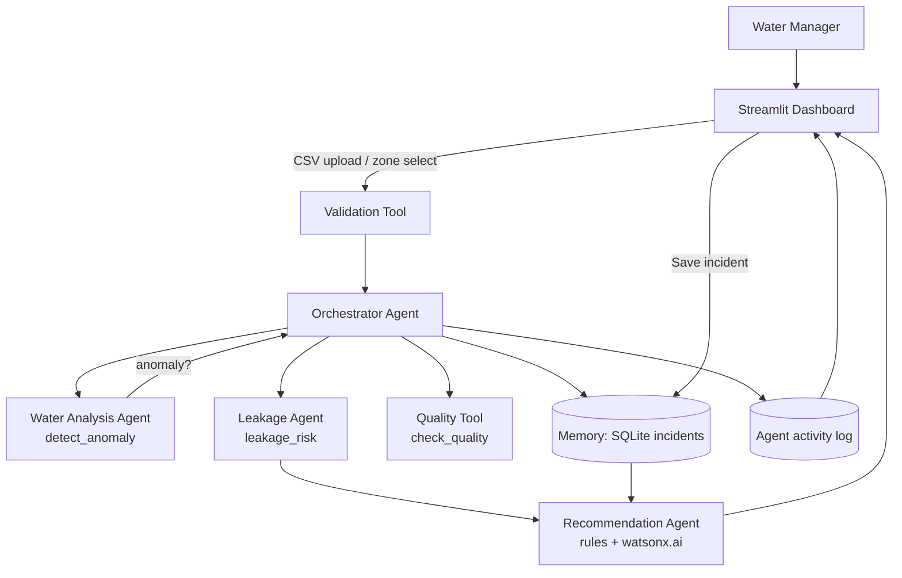
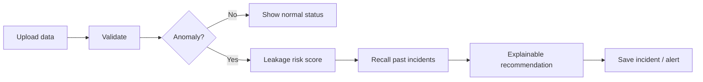

# Architecture

# Flowchart

# Leakage risk score (prototype indicator, not proof of a leak)
Consumption anomaly +40 · night flow ≥3× +30 · pressure drop ≥10% +20 · persistence +10. HIGH ≥70, MEDIUM ≥40.
